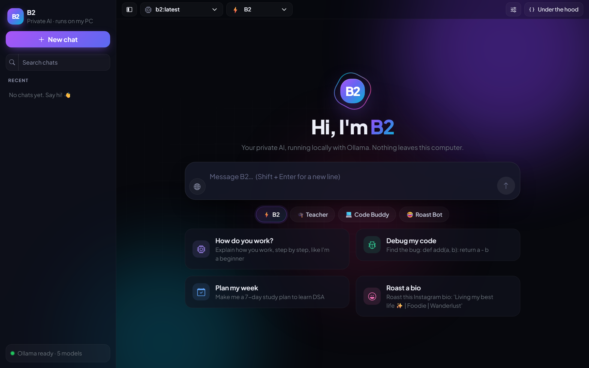
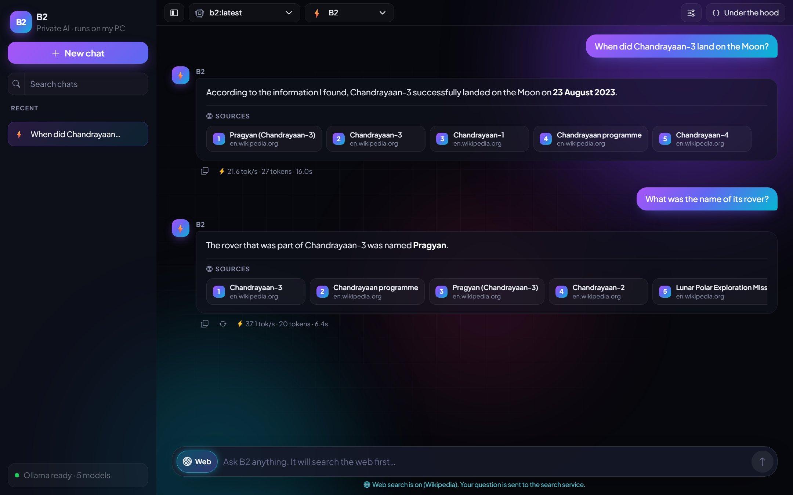

<div align="center">

# ⚡ B2: my personal AI chatbot

**A private, ChatGPT-style AI assistant that runs 100% on my own PC, with my own versioned model.**

React · Python · Ollama · Qwen3 4B · RAG web search



</div>

---

## ✨ Features

- **Runs locally.** No cloud, no API bill. Chats never leave the computer.
- **My own model, `b2`.** Built from versioned [Modelfiles](models/) (`b2:v1`, `b2:v2`, …) with one-command upgrades and rollback.
- **🌐 Web search with citations (RAG).** The model rewrites your question into a search query, reads the results and answers with `[1] [2]` source cards. Follow-up questions like *"what was its rover?"* work too.
- **Streaming answers** that appear word by word, with full markdown, tables and code blocks you can copy.
- **🔍 "Under the hood" panel** that shows the exact prompt sent to the model, token counts, speed and every web-search step. Built for learning how LLMs really work.
- **Personas:** B2, Teacher, Code Buddy and Roast Bot. Each is just a system prompt in [`personas.json`](personas.json).
- **Modern UI:** Bootstrap 5 dark theme, Framer Motion animations, an animated aurora background, a ChatGPT-style chat box that moves from the centre to the bottom, and phone support.
- **Chat history** with search, regenerate and a temperature control.



---

## 🚀 Quick start (Windows)

**You need:** [Ollama](https://ollama.com), [Python 3.10+](https://python.org) and [Node.js 18+](https://nodejs.org). Then:

```bash
# 1. Download the base model (~2.5 GB, once)
ollama pull qwen3:4b-instruct-2507-q4_K_M

# 2. Build my custom model  ->  creates b2:v2 and b2:latest
build_model.bat v2

# 3. Start the app (first run installs and builds the React UI)
start.bat
```

This opens **http://localhost:8000**.

> If `ollama` isn't recognised, use the full path `"%LOCALAPPDATA%\Programs\Ollama\ollama.exe"`.
> On macOS/Linux: `ollama create b2:v2 -f models/v2/Modelfile`, then `cd frontend && npm install && npm run build`, then `python3 server.py`.

---

## 🧠 How it works

```
Browser (React)  ──/api/chat──▶  server.py (Python)  ──▶  Ollama  ──▶  b2:latest (Qwen3 4B)
      ▲                               │
      └──── streamed answer ──────────┘──(🌐 on)──▶  Wikipedia / Ollama Web Search
```

1. The browser sends the **whole conversation** every time. The model itself has no memory.
2. [`server.py`](server.py) adds the persona and, when 🌐 is on, runs [`web_search.py`](web_search.py) and pastes the results into the prompt (RAG).
3. Ollama runs `b2:latest` on the GPU and streams the answer back token by token.

## 🧬 Model versions

| Version | Base | What's new |
|---|---|---|
| `b2:v1` | Llama 3.2 3B | Personality and identity baked in with a Modelfile |
| **`b2:v2`** (current) | Qwen3 4B Instruct | Apache 2.0 base, smarter, Hindi/Hinglish |
| `b2:v3` (planned) | v2 + LoRA fine-tune | Trained on my own example chats |

Upgrade: add `models/v3/Modelfile`, then run `build_model.bat v3`. Roll back: `ollama cp b2:v1 b2:latest`.
Details are in [models/README.md](models/README.md).

---

## 📁 Project structure

```
server.py            Python backend (standard library only): UI, Ollama proxy, web search
web_search.py        RAG: search -> paste results into the prompt -> cite sources
personas.json        system prompts for each persona
models/              versioned Modelfiles (v1, v2, ...) + build_model.bat
frontend/            React + Vite app (components in src/components/)
static/              first plain-HTML version (fallback)
DEVELOPER_GUIDE.md   full step-by-step build log (also as a PDF)
```

## 🛠️ Development

```bash
py server.py                  # terminal 1: backend on :8000
cd frontend && npm run dev    # terminal 2: live-reload UI on :5173
```

Then run `npm run build` so `start.bat` serves your changes.

**Optional: full web + news search.** Create a free API key at ollama.com (Settings → API keys) and save it as
`ollama_api_key.txt` in this folder. The file is git-ignored, so never commit it. Without a key, B2 searches Wikipedia.

📘 Everything (setup, every step with reasons, upgrading, troubleshooting) is in the
**[Developer Guide](DEVELOPER_GUIDE.md)** ([PDF](DEVELOPER_GUIDE.pdf)).

---

## 💡 What I learned

- **LLMs have no memory.** The chat history *is* the memory, resent every time.
- **System prompt = personality.** The same model with a different first message becomes a different bot.
- **RAG** gives a frozen model fresh facts without retraining.
- **`num_ctx` must stay constant.** Changing it makes Ollama reload the model (slow).
- **Pick Instruct, not Thinking, variants** for fast chat on small GPUs.
- **Licenses matter.** Llama-based models must be named "Llama…" when shared, so v2 moved to Apache 2.0 Qwen3.

## 🗺️ Roadmap

- [x] Local chat app with streaming, personas and history
- [x] React + Bootstrap UI with animations
- [x] Web search (RAG) with citations
- [x] Custom versioned model (`b2:v1`, `b2:v2`)
- [ ] Fine-tune `b2:v3` on my own data (Unsloth + Colab)
- [ ] Chat with my own documents (PDF/notes embeddings)
- [ ] Tool calling (calculator, time, files)
- [ ] Voice input and output

## 📜 License

- **My code** (UI, server, scripts, docs): [MIT](LICENSE)
- **Models are not included** in this repo. They download through Ollama under their own licenses:
  Qwen3 is Apache 2.0, and Llama 3.2 uses the Llama 3.2 Community License.
- Web results come from Wikipedia (CC BY-SA) and are shown with links to the source.

<div align="center">

Built by **Anubhav** as a learning project 🚀

</div>
